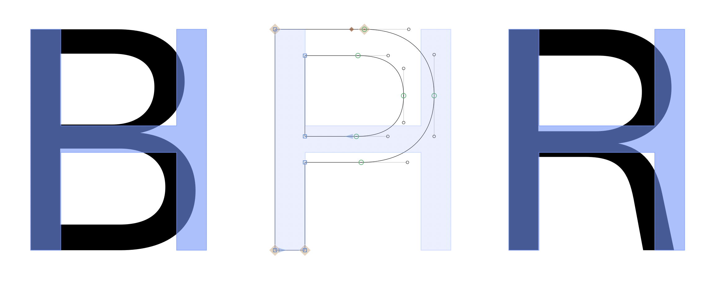
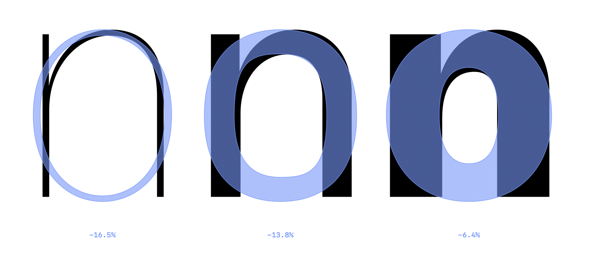

<p align="center">
  
</p>

<h1 align="center">AZ Shadow</h1>

<p align="center">
  <strong>See every glyph against your H, right where you draw it.</strong>
</p>

<p align="center">
  <a><picture>
    <source media="(prefers-color-scheme: dark)" srcset="https://img.shields.io/badge/Free_Plugin-6690e3">
    
  </picture></a>
  <a href="https://azerty-typefaces.com"><picture>
    <source media="(prefers-color-scheme: dark)" srcset="https://img.shields.io/badge/More_AZ_plugins-242424">
    
  </picture></a>

</p>

---

<p align="center">
   
</p>


AZ Shadow is a [GlyphsApp](https://glyphsapp.com/) plugin that displays a reference glyph on top of every layer in your tabs. It works as an alternative to the background layer, staying visible on the canvas while you edit. Widths, heights and weights can be checked against it at a glance: an n that is too wide, a round that overshoots too far, a stem that drifts.


<br>

## Getting started

1. Install AZ Shadow with the link for your Glyphs version:
   - **Glyphs 3:** [Install in Glyphs 3](https://azerty-typefaces.github.io/AZ-Shadow/install.html?v=3)
   - **Glyphs 4:** [Install in Glyphs 4](https://azerty-typefaces.github.io/AZ-Shadow/install.html?v=4)

   Or open *Window ▸ Plugin Manager*, find **AZ Shadow** and click *Install*.
2. Restart Glyphs.
3. Turn the reporter on: *View ▸ Show AZ Shadow*.
4. Open any glyph in an Edit tab. The H is drawn over it, centred on its advance width.
5. Pick another glyph, colour, alignment or scope in the **AZ Shadow** palette, in the right sidebar.

The reference glyph itself gets no shadow, and neither do empty glyphs. When the font has no glyph by the name you typed, nothing is drawn.

<br>

## Palette View

| Control | Does |
| --- | --- |
| **Glyph field** | The glyph drawn over: its name, like `H` or `n.alt`. Pause while typing and the font's glyph names that start with what you typed are listed |
| **Colour well** | The shadow's colour. The colour panel's opacity slider sets how strong it is |
| **Alignment** | Left edges flush, advance widths centred, or right edges flush |
| **Scope** | The glyph you edit only, or every glyph in the tab |

<br>

## Width difference

<p align="center">
   
</p>


You can display the width difference, in %, between each glyph's bounding box and the shadow's (sidebearings left out).  
Turn it on in *Window ▸ Macro Panel*, then *Run*:

```python
Glyphs.defaults["com.hugojourdan.AZShadow.width_diff"] = True
```

<br>

## Feedback

Bugs and ideas go to the [issue tracker](https://github.com/azerty-typefaces/AZ-Shadow/issues).

<br>

## Credits

Copyright © 2026 [Hugo Jourdan](https://azerty-typefaces.com). All rights reserved.

Made possible with the GlyphsSDK by Georg Seifert (@schriftgestalt) and Rainer Erich Scheichelbauer (@mekkablue).
